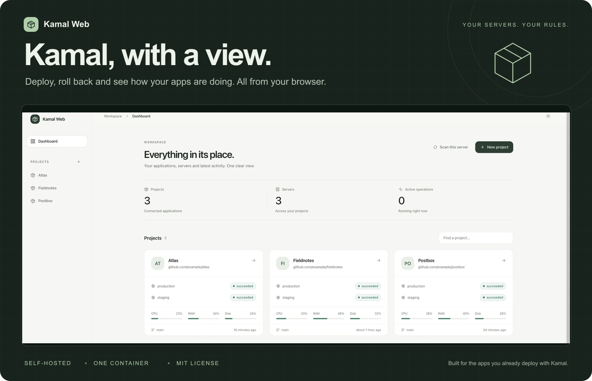
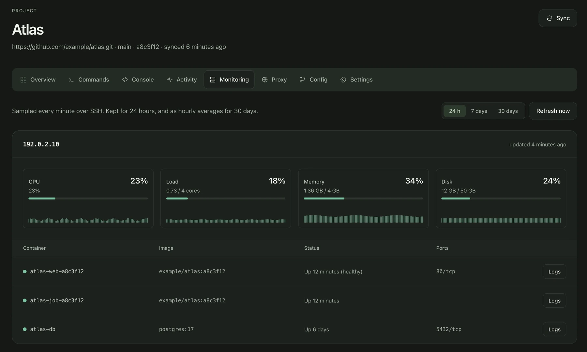
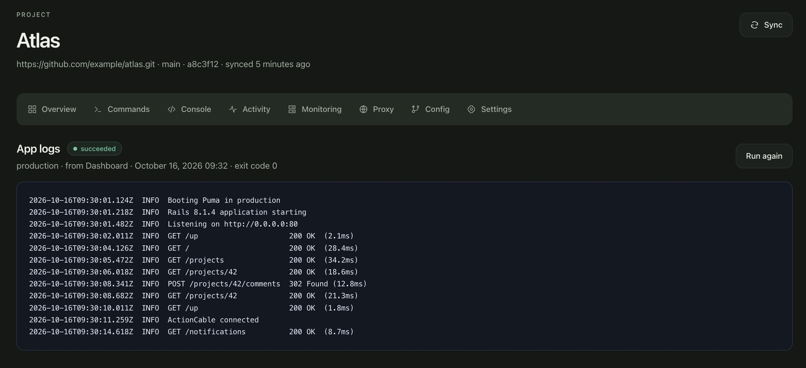

# Kamal Web

**Your Kamal apps. One clear view.**

A self-hosted dashboard for the apps you deploy with [Kamal](https://kamal-deploy.org). Ship a release, roll back, follow logs and check your servers from your browser. Your existing repositories and Kamal configs, with a place to see it all.

**[Install →](#install)** · [Take a closer look](#a-closer-look) · [Configuration](#configuration) · [Security](#security-model)

[](docs/images/dashboard.webp)

<sub>Real interface, fictional projects and sample metrics. Click the cover for a larger dashboard view.</sub>

Runs as **one container on your own server**, alongside your apps. SQLite included. No hosted account or subscription. [MIT licensed](LICENSE).

## Features

| What you want to do | What Kamal Web gives you |
| --- | --- |
| **See what is running** | A project dashboard with destinations, recent deploys and server resource usage. Automatically discovers Kamal apps on its own server. |
| **Ship with context** | Deploy, redeploy and roll back, with pending commits, deploy locks, protected destinations and streaming output. |
| **Find out what happened** | Live app, proxy and accessory logs, command history, plus an interactive Rails console, database console or shell. |
| **Keep an eye on your servers** | CPU, memory, disk, containers, HTTP health checks, TLS expiry and alerts, with up to 30 days of metric history. |
| **Keep configuration together** | Git repositories, destination-specific encrypted secrets, secret files and SSH keys. |
| **Keep your team in the loop** | Slack, Discord or JSON webhooks, deploy hooks for CI and a live, read-only status board. |

English and Spanish. Light and dark themes. One shared password, with optional authenticator codes and IP restrictions.

<details>
<summary><strong>Explore all features</strong></summary>

- **Finds the Kamal apps already on the server.** On boot and every 5 minutes, Kamal Web looks at the containers on its own server (through the Docker socket) and adds every Kamal app it finds, with its destinations, roles, accessories and domains. No setup beyond `kamal authorize`.
- **Projects from git or a mounted folder.** Kamal Web clones your repository (over SSH deploy keys or HTTPS tokens), pulls before every command and detects destinations such as `config/deploy.staging.yml` automatically.
- **Deploy, redeploy, rollback.** Output streams live next to the app's containers on every host, so you see the new version start and the old one stop. Runs can be canceled, and only one server-changing command runs per project at a time.
- **Know what you deploy.** Next to the Deploy button: the commits between the live version and the branch, and whether Kamal's deploy lock is held (with a button to release it). Destinations such as `production` can be protected, so changing them asks you to type their name first.
- **Checks.** The overview tells you at a glance whether the config loads, SSH works, kamal-proxy and the app are running and every secret is set, and how to fix what isn't.
- **Versions on the server.** The overview lists the versions Kamal still keeps on the server and rolls back to any of them in one click.
- **Every everyday Kamal command:** app boot/start/stop/details/logs/exec, maintenance and live mode, accessories, proxy, deploy lock, prune, registry login, server bootstrap, setup and audit.
- **Live logs.** Follow app, proxy or accessory logs as they're written, from any host or a single container (one click from the Monitoring tab). Following stops after 30 minutes or when you press Stop.
- **Web console.** An interactive Rails console, database console or shell in the running app container, right in the browser (`kamal app exec --interactive --reuse`). Every session is recorded (what, where, when); what you type isn't.
- **Rails runner.** Evaluates Ruby inside the running app container.
- **Monitoring.** CPU, memory, disk and load for every host, sampled each minute over SSH and kept for 24 hours, plus hourly averages for 30 days and the running containers.
- **Health checks.** Every domain is requested at its health check path (`/up` by default) each minute, from outside, like a visitor. The overview shows the response time, uptime over 24 hours and when the TLS certificate expires.
- **Alerts.** Kamal Web opens an alert when a host is unreachable over SSH, its disk or memory is almost full, the app isn't running, a domain fails its health check, a certificate expires within 14 days or kamal-proxy returns more than 10% 5xx responses. Alerts show on the dashboard and are posted to the project's notification webhook when they open and when they resolve.
- **Proxy view.** kamal-proxy routes and TLS state, plus the app's traffic over the last hour: requests per minute by status, median and p95 latency, and the latest requests.
- **Secrets.** Encrypted environment variables (per destination) for `.kamal/secrets`, and secret files such as `config/master.key`. SSH keys are encrypted and only loaded into a temporary ssh-agent while a command runs.
- **One password.** No accounts to manage: the password lives in your Kamal secrets.
- **Notifications.** Slack, Discord or JSON webhooks when an operation finishes or an alert opens or resolves, plus browser notifications.
- **Deploy webhook.** Trigger deploys from CI or a GitHub/GitLab push.
- **Status board.** A read-only page for a TV or for stakeholders, behind a secret URL. It updates live as deploys run and metrics arrive.
- **English and Spanish, light and dark.** Follows the browser's language and theme, or pick them in the sidebar.
- **Backups.** Download everything from Settings and restore it in one step, or turn on a daily backup kept in the volume.
- **Update notice.** The sidebar tells you when a new Kamal Web release is out.

</details>

## Install

**You need:** [Kamal](https://kamal-deploy.org/docs/installation/) and Docker on your machine, plus a server you can reach over SSH. A domain and a registry account are optional.

Kamal Web is a Kamal app itself: you deploy it from your machine to one of your servers, next to the apps it manages.

**1. Clone the project.**

```sh
git clone https://github.com/kengallego/kamal-web.git && cd kamal-web
cp .env.example .env
```

**2. Set your server and password** in `.env` (at least 12 characters):

```sh
KAMAL_WEB_SERVER=203.0.113.10
KAMAL_WEB_PASSWORD=a long password
```

**3. Deploy and authorize access** to the server:

```sh
kamal setup
kamal authorize
```

Open `https://kamal.203-0-113-10.sslip.io` (your IP with dashes) and sign in with the password. There are no user accounts: everyone who knows the password has full access.

kamal-proxy serves Kamal Web over HTTPS with a Let's Encrypt certificate, next to your other apps. [sslip.io](https://sslip.io) gives the IP a name a certificate can be issued for; set `KAMAL_WEB_HOST` in `.env` to use a domain of your own instead. No registry account is needed either: images go through a registry Kamal runs on your machine.

`.env` also takes `KAMAL_WEB_SSH_USER` when your servers don't use `root`, and `KAMAL_WEB_BUILD_ON_SERVER=true` to build the image on the server, which is much faster from an Apple Silicon Mac. You don't need to edit `config/deploy.yml`.

### Updating

```sh
git pull
kamal deploy
```

To change the password, change `KAMAL_WEB_PASSWORD` in `.env` and run `kamal deploy`. That signs everybody out.

### Apps already running on the server

Kamal Web finds them by itself after the first deploy. Kamal still reaches them over SSH, which is what `kamal authorize` sets up: it adds Kamal Web's key to `~/.ssh/authorized_keys` on the server, as the user Kamal connects with (`KAMAL_WEB_SSH_USER`, `root` by default). Running it again does nothing.

For apps on other servers, **Settings** has a command to run on each of them.

Detected apps get logs, the web console, monitoring, the proxy view and every read-only command straight away. Their config comes from the `config/deploy*.yml` inside the deployed image when there is one, or is rebuilt from the containers and kamal-proxy routes. That config has none of the app's env or secrets, so deploys and anything that recreates containers stay disabled until you add the app's git repository in the project settings. Starting, stopping and maintenance mode work.

You can keep deploying with `kamal deploy` from your machine or from CI, such as a GitHub Actions job on pushes to `main`. Kamal Web shows each new version under releases either way. Add the repository only if you want Kamal Web itself to run deploys, from its Deploy button or the deploy webhook.

New apps are picked up within 5 minutes, or right away with **Scan this server** on the dashboard. A detected project you delete isn't added again (Settings lets you undo that). Kamal Web never lists itself.

Kamal Web reaches its own server at the container's default gateway. If SSH listens elsewhere, set `KAMAL_WEB_HOST_ADDRESS` under `env.clear` in `config/deploy.yml`.

### Adding a project

1. **New project.** Enter the repository URL and branch. Private repositories need either an HTTPS token or a deploy key.
2. **SSH private key.** This is the key Kamal uses to reach your servers. Without a passphrase. Leave it empty to use Kamal Web's own key, which `kamal authorize` and Settings let in.
3. **Settings → Environment variables.** Add whatever your `.kamal/secrets` reads, such as `KAMAL_REGISTRY_PASSWORD` or `RAILS_MASTER_KEY`. Use secret files for `config/master.key`.
4. Press **Sync**, then **Deploy**.

## A closer look

### Know how your servers are doing

CPU, load, memory and disk in one view, with running containers and a shortcut to their logs. Switch between 24 hours, 7 days and 30 days to see how usage changes. HTTP health checks and alerts help you catch problems beyond resource usage.



### Go from a container to its logs

Read command output in the browser and follow app, proxy or accessory logs as they arrive. Open a Rails console, database console or shell when you need to dig further.



<sub>Screenshots use fictional projects, documentation-only IP addresses and sample data. The log view shows a completed example run.</sub>

**[Ready to try it? Install Kamal Web →](#install)**

## Configuration

| `.env` | Default | |
|---|---|---|
| `KAMAL_WEB_SERVER` | | Required. The server Kamal Web runs on |
| `KAMAL_WEB_PASSWORD` | | Required. At least 12 characters |
| `KAMAL_WEB_HOST` | `kamal.<ip>.sslip.io` | Domain Kamal Web is served at |
| `KAMAL_WEB_SSH_USER` | `root` | User Kamal connects as |
| `KAMAL_WEB_BUILD_ON_SERVER` | `false` | Build the image on the server instead of your machine |
| `KAMAL_WEB_TOTP_SECRET` | | Also ask for a code from an authenticator app |
| `KAMAL_WEB_ALLOWED_IPS` | | Only these IPs or networks can open the dashboard |

Less common settings go under `env.clear` in `config/deploy.yml`:

| Variable | Default | |
|---|---|---|
| `KAMAL_WEB_HOST_ADDRESS` | container gateway | Address Kamal Web uses to SSH into its own server, for detected apps |
| `SECRET_KEY_BASE` | generated | Generated and stored in the volume when unset |

### Protecting the sign-in

Kamal Web controls your servers, so it's worth more than a password:

- **Authenticator app.** Run `bin/totp-secret`, add the line it prints to `.env`, add the key to an authenticator app (1Password, Google Authenticator, Aegis…) and `kamal deploy`. Signing in then asks for the 6-digit code too.
- **Allowed IPs.** `KAMAL_WEB_ALLOWED_IPS=203.0.113.7,198.51.100.0/24` in `.env` makes the dashboard answer only those addresses. The deploy webhook and the status board keep working from anywhere, since they have their own secret URLs.

Sign-in attempts are limited to 10 every 3 minutes per IP. Changing the password or the TOTP secret signs everybody out.

### Backups

**Settings → Download backup** saves the database (projects, encrypted variables, settings, history) and the key that decrypts it in one `.tar.gz`. Anyone with the file can read every secret in it, so keep it safe.

**Settings → Back up every day** (off by default) writes a backup to `storage/backups` in the volume at 3:00 and keeps the last 7, or as many as you choose. It protects against mistakes but not against losing the server, so download one now and then.

**Settings → Restore** replaces the instance's data with a backup and restarts Kamal Web to apply it. The replaced files stay in the volume under `storage/before-restore-*`.

### History

Command runs and console sessions are deleted after 90 days, but the latest 50 runs of each project are always kept. Resolved alerts are kept for 30 days.

### Update check

Once a day Kamal Web asks GitHub for its latest release and shows a notice when there's a newer one. Nothing else is sent. To turn it off, add `KAMAL_WEB_UPDATE_CHECK: false` under `env.clear` in `config/deploy.yml`.

### Building images

Kamal Web builds your apps' images with the server's Docker, through the socket mounted in `config/deploy.yml`. **Anything that can use that socket controls the server, so only share the password with people you trust with it.** If all your projects use a [remote builder](https://kamal-deploy.org/docs/configuration/builder/) you can remove the socket mount, but apps on the server are then no longer detected.

### Mounted projects

If your projects already live on the server, mount them in `config/deploy.yml` and add them as **Mounted folder**:

```yaml
volumes:
  - /srv/projects:/projects
```

## Security model

- Secrets (SSH keys, tokens, variables, files, webhook URLs) are encrypted with Active Record encryption and never rendered back into forms.
- Commands come from a fixed catalog and run without a shell. Options are validated.
- Child processes get an allowlisted environment, so the instance's own secrets never reach your project's hooks.
- Deploy webhook and status board URLs use long random tokens and can be regenerated.
- Sign-in is rate limited, can require a code from an authenticator app and can be limited to some IPs. Sessions are tied to the password and the TOTP secret, so changing either signs everybody out.
- Web consoles can only be attached once, and close when the page is left or after 30 minutes idle.
- Interactive consoles and followed logs use the system `ssh`, which trusts a server's host key the first time it connects and refuses it if it later changes.

## Development

```sh
bin/setup
bin/dev            # http://localhost:3000
bundle exec rspec
```

In development the password is `kamal-web-development` unless `KAMAL_WEB_PASSWORD` is set.

Built with Rails 8, Hotwire, Tailwind, ViewComponent, SQLite and Solid Queue/Cable/Cache. Kamal runs as a subprocess, using the version pinned in this app's `Gemfile.lock`.

## License

MIT
